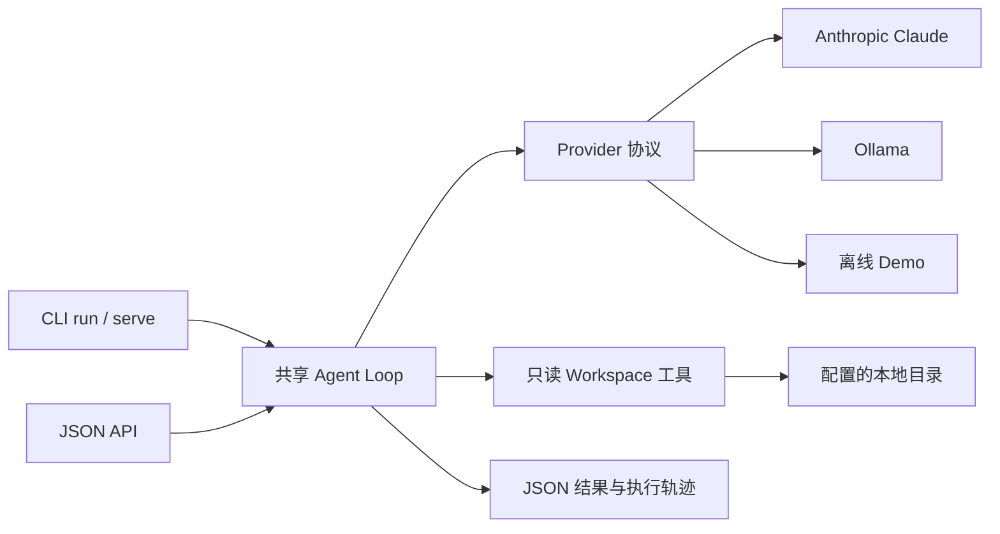

# Agent Provider Lab

把教学 Agent Loop 扩展为支持 Claude、Ollama 与离线演示的只读仓库助手，提供统一 CLI、JSON API、调用预算和执行轨迹。

[](https://github.com/2855313278/learn-claude-code/actions/workflows/provider-lab.yml)
[](LICENSE)

本项目衍生自 **[shareAI-lab/learn-claude-code](https://github.com/shareAI-lab/learn-claude-code)**，基线提交 `ce8f9f186058939da54c9d6fead78dfb5d0fd6c3`。原作者为 **shareAI Lab 及原项目贡献者**，原始 MIT License、版权声明和 Git 历史完整保留。原项目入口见 [README.upstream.md](README.upstream.md)，原中文课程说明见 [README-zh.md](README-zh.md)。新增模块由 **2855313278** 维护，使用 Codex 协助实现；本项目与上游官方无隶属关系。

## 新增能力

- **统一 Provider**：用同一套消息、工具调用和结果结构接入 Anthropic Claude、Ollama 原生 API；云端模型通过参数指定。
- **CLI 与本地 API**：两种入口复用同一个执行循环；每次请求独立历史，输出 JSON 结果与工具轨迹。
- **可控执行**：1–20 次模型调用预算；区分完成、预算耗尽与输出截断；工具只支持目录列表与文本读取。
- **可复现演示**：默认 `demo` 不访问网络、不需要密钥，固定执行一次目录读取并返回结果。它是测试用确定性 Provider，不具备语言模型推理能力。

原始 `s01_*` 至 `s17_*` 课程、`agents/` 旧版示例和 `web/` 教学网站保留。新功能均位于 `provider_lab/`；原课程继续按其自身说明运行。

## 快速开始

需要 Python 3.11+ 和 Git。Windows PowerShell：

```powershell
git clone https://github.com/2855313278/learn-claude-code.git
cd learn-claude-code
python -m venv .venv
.\.venv\Scripts\python.exe -m pip install -r requirements-lab.txt
.\.venv\Scripts\python.exe -m provider_lab run "列出工作区文件" --provider demo --workspace .
```

Linux / macOS：

```bash
git clone https://github.com/2855313278/learn-claude-code.git
cd learn-claude-code
python3 -m venv .venv
.venv/bin/python -m pip install -r requirements-lab.txt
.venv/bin/python -m provider_lab run "List workspace files" --provider demo --workspace .
```

只体验 demo 时，可省略依赖安装，直接运行 `python -m provider_lab run "List files"`。demo、Ollama HTTP 客户端与 API 层使用 Python 标准库；Anthropic 模式需要 SDK，测试需要 pytest 与 Ruff。

结果中 `status` 为 `completed`、`steps` 为 `2`，`trace[0].tools[0]` 记录一次 `list_files` 调用。文件列表随工作区而变。

## 使用真实模型

### Claude

为当前进程设置自己的凭据，并将 `YOUR_CLAUDE_MODEL_ID` 替换为账户可用、支持工具调用的模型 ID：

```powershell
$env:ANTHROPIC_API_KEY = 'YOUR_API_KEY'
.\.venv\Scripts\python.exe -m provider_lab run "阅读 README.md，概括项目架构" --provider anthropic --model YOUR_CLAUDE_MODEL_ID --workspace . --max-steps 4
```

新增 CLI 从进程环境读取凭据，不自动加载上游 `.env`，以免意外继承教学示例配置。选择云端模式后，提示词与工具读取的文件内容会发送给所选服务。适配器面向文本与客户端工具调用，未实现多模态、流式输出或扩展思考消息。

### Ollama

先自行安装并启动 Ollama，拉取一个支持工具调用的模型；将 `YOUR_INSTALLED_MODEL` 替换为 `ollama list` 显示的模型名：

```powershell
$env:OLLAMA_HOST = 'http://127.0.0.1:11434'
.\.venv\Scripts\python.exe -m provider_lab run "阅读 README.md，概括项目架构" --provider ollama --model YOUR_INSTALLED_MODEL --workspace . --max-steps 4
```

`OLLAMA_HOST` 只能是 HTTP(S) origin，不含路径、查询参数或账号密码；本机地址自动绕过系统代理。项目不自动下载模型。

协议参考：[Claude Messages API](https://platform.claude.com/docs/en/api/python/messages/create)、[Ollama Chat API](https://docs.ollama.com/api/chat)。

## 本地 JSON API

终端一启动服务：

```powershell
.\.venv\Scripts\python.exe -m provider_lab serve --provider demo --workspace . --port 8000
```

终端二发起请求：

```powershell
Invoke-RestMethod http://127.0.0.1:8000/health
$body = @{ prompt = '列出工作区文件'; max_steps = 4 } | ConvertTo-Json
$result = Invoke-RestMethod http://127.0.0.1:8000/v1/runs -Method Post -ContentType 'application/json; charset=utf-8' -Body ([Text.Encoding]::UTF8.GetBytes($body))
$result | ConvertTo-Json -Depth 10
```

启动服务时也可指定 `--provider anthropic --model ...` 或 `--provider ollama --model ...`。按 Ctrl+C 停止服务。

| 接口 / 字段 | 行为 |
| --- | --- |
| `GET /health` | 返回服务状态、Provider 与模型名；不验证远端模型连通性 |
| `POST /v1/runs` | 请求体只接受 `prompt` 和可选的 `max_steps` |
| `prompt` | 非空字符串，最多 8000 字符；整个请求体最多 16 KiB |
| `max_steps` | 1–20 的整数，默认 4；计数包含最终回答所需的模型调用 |
| `status` | `completed`、`step_limit` 或 `output_limit`，不能只凭 HTTP 200 判断完成 |
| `trace` | 每步文本、用量、模型调用耗时，以及工具名、参数、结果 |
| CLI 退出码 | 0：完成；1：预算/输出受限；2：配置或 Provider 错误 |

API 对输入错误返回 400、非 JSON 返回 415、过大请求返回 413、并发超过两次运行返回 429、Provider 错误返回 502。未知路径返回 404。

服务仅绑定 `127.0.0.1`，拒绝浏览器 Origin 和非本机 Host；当前面向直接本地 API 客户端。它没有用户认证或生产级部署能力，不应通过反向代理暴露到公网。

## 架构与目录



```text
provider_lab/
  providers.py          # Turn / ToolCall 协议与三个 Provider
  runtime.py            # 执行循环、预算、目录与文本读取
  api.py                # 本机 HTTP 服务与请求边界
  __main__.py           # CLI 入口
tests/test_lab_*.py     # Provider、runtime、HTTP、CLI 回归测试
scripts/verify_lab.py  # 一条命令执行验收
requirements-lab.txt   # 本次验证使用的固定依赖版本
ruff-lab.toml          # 新模块独立 lint / 格式规则
.github/workflows/provider-lab.yml
README.upstream.md     # 原始 README 完整备份
LOG.md                 # 选品评分、逐文件记录、命令与限制
s01_*/ ... s17_*/      # 保留的原课程
agents/                # 保留的旧版示例
web/                   # 保留的上游教学网站
```

工具拒绝绝对路径、`..`、隐藏路径及名称包含 `secret` / `credential` 的路径，并检查解析后的目标仍位于工作区。文本限于支持的扩展名，每次最多读取 16 KiB；目录最多展示 200 项。该机制适用于受信任的本地目录，不是操作系统沙箱，也不能识别任意文件内容中的秘密。轨迹包含实际读到的内容，请自行选择可分享的工作区。

## 验证

在仓库根目录，Windows 执行：

```powershell
.\.venv\Scripts\python.exe -X utf8 scripts/verify_lab.py
```

该命令依次执行依赖完整性、lint、格式、编译、新增测试及原课程编译/文档冒烟测试。Linux 运行完整上游回归：

```bash
.venv/bin/python scripts/verify_lab.py --upstream
```

CI 覆盖 Ubuntu Python 3.11 / 3.13 和 Windows Python 3.13。上游完整测试使用 `fcntl`、POSIX 行为及 LF 假设，原基线在本机 Windows 为 381 通过、123 失败；不将它们描述为已解决。Windows 的符号链接逃逸测试在没有创建权限时跳过，Linux CI 执行该用例。

在线 Claude 与真实 Ollama 模型推理尚未实测；当前已验证协议合约、模拟模型响应、真实本地 HTTP 通信和离线端到端运行。精确结果和逐文件验证命令见 [LOG.md](LOG.md)。

## 许可证与致谢

[MIT License](LICENSE)，原版权声明 **Copyright (c) 2024 shareAI Lab** 保持原样。

感谢 [shareAI Lab](https://github.com/shareAI-lab) 和 [learn-claude-code 原项目贡献者](https://github.com/shareAI-lab/learn-claude-code/graphs/contributors) 提供 Agent Loop 课程与测试基础。原 README 的作者介绍、课程导航与项目链接完整保存在 [README.upstream.md](README.upstream.md)。
